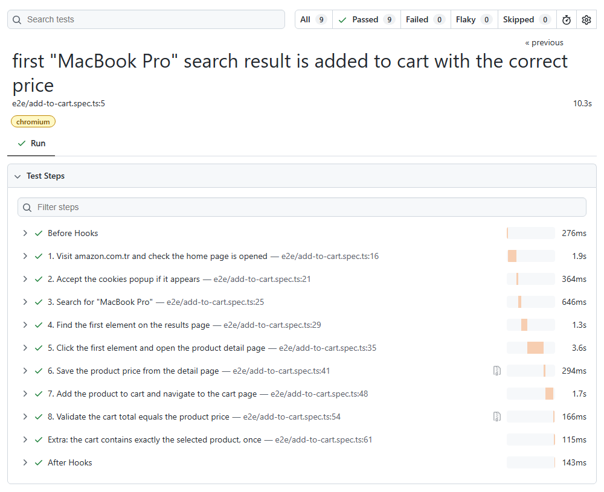

# Amazon.com.tr UI Automation

[](https://github.com/ugursaglamm/amazon-playwright-automation/actions/workflows/playwright.yml)

End-to-end UI test that searches for **"MacBook Pro"** on amazon.com.tr, opens the first result,
adds it to the cart and validates that the cart total equals the product price — plus extra checks
that the cart contains exactly the selected product.



## Technologies

| Tool | Purpose |
| --- | --- |
| [Playwright Test](https://playwright.dev) | Browser automation, test runner, assertions, HTML report, trace/video |
| TypeScript (strict mode) | Type-safe test code |
| Node.js 22 | Runtime |
| GitHub Actions | CI: type check + all tests on every push / PR, report uploaded as artifact |

## Scenario coverage

| # | Step | Implementation |
| --- | --- | --- |
| 1 | Visit amazon.com.tr, check home page is opened | URL, title, logo and search bar are verified |
| 2 | Accept cookies popup if it occurs | Accepted only if it appears within 5 s |
| 3 | Type "MacBook Pro" into the search bar | `HomePage.search()` |
| 4 | Find the first element in the results | First result card; its ASIN (Amazon product id) is stored |
| 5 | Click it, navigate to the detail page | Detail page ASIN must equal the clicked result's ASIN |
| 6 | Save the product price | Parsed to a number; screenshot attached to the report |
| 7 | Add to cart, navigate to cart page | Through the "Sepete Git" button, like a real user |
| 8 | Cart total equals product price | Numeric comparison; screenshot attached to the report |
| + | **Extra checks** (soft assertions) | Exactly 1 line item, it is the selected ASIN, quantity is 1, header cart counter is 1, cart title matches the product title |

## Project structure

```
├── .github/workflows/playwright.yml  # CI pipeline
├── fixtures/pages.ts                 # Injects page objects into tests as fixtures
├── pages/                            # Page Object Model: one class per page
│   ├── HomePage.ts                   # open (+ bot-check handling), verify, cookies, search
│   ├── SearchResultsPage.ts          # first result, its ASIN, open result
│   ├── ProductPage.ts                # title, ASIN, price, add to cart, go to cart
│   └── CartPage.ts                   # items, quantity, subtotal, header counter
├── tests/
│   ├── e2e/add-to-cart.spec.ts       # the scenario, one test.step per case step
│   └── unit/price.spec.ts            # unit tests for the price parser (no browser)
├── utils/price.ts                    # "149.990,00 TL" -> 149990
├── playwright.config.ts
└── tsconfig.json
```

## Running

```bash
npm install
npx playwright install chromium

npm test                 # unit + e2e
npm run test:e2e         # only the browser scenario
npm run test:unit        # only the unit tests (milliseconds, no browser)
npm run test:headed      # watch the browser
npm run report           # open the HTML report
npm run typecheck        # TypeScript type check

SEARCH_TERM="iPhone 15" npm run test:e2e   # same scenario with another search term
```

## Approach & design decisions

- **Page Object Model + fixtures** — selectors and page actions live in `pages/`. A custom
  fixture (`fixtures/pages.ts`) injects the page objects into the test, so the spec contains only
  the scenario: `async ({ homePage, cartPage }) => ...`.
- **`test.step` per scenario step** — the report shows exactly which of the 8 steps failed.
- **No fixed waits** — Playwright auto-waiting and web-first assertions
  (`expect(locator).toBeVisible()`) are used instead of `sleep`/`waitForTimeout`.
- **Meaningful failure messages** — assertions carry a message that explains the likely cause,
  e.g. *"'Sepete ekle' button should exist; the product may be out of stock…"* instead of a bare
  timeout. A CAPTCHA on the home page is detected and reported explicitly.
- **Prices compared as numbers** — both prices are parsed from Turkish format
  (`.` thousands, `,` decimals); the parser is covered by unit tests, including invalid input.
- **Verifying the right product, not only the right price** — ASIN is tracked from the result
  card to the detail page to the cart. The extra checks use *soft assertions* so a single run
  reports every mismatch.
- **Evidence & debugging** — screenshots of the product and cart pages are attached to every
  report; trace, video and screenshot are kept for failed runs.

## Challenges

- **Cookie banner is not always shown** (it depends on region/session), so it is accepted only if
  it appears within a short timeout.
- **The first result is usually a sponsored listing.** The scenario asks for the *first element*,
  so the test deliberately clicks the first result, sponsored or not. (Organic-only would be
  `[data-component-type="s-search-result"]:not(.AdHolder)`.)
- **Duplicate "Sepete ekle" button** — the product page contains a hidden copy with the same id,
  which caused a strict-mode violation; the `:visible` filter targets the real one.
- **Price split across several `<span>`s** (`149.990` / `,` / `00` / `TL`) on the detail page,
  while the cart shows `149.990,00 TL`; both are normalised by `parsePrice`.
- **Intermediate "smart wagon" page after adding to cart** — the test continues through its
  "Sepete Git" button.
- **Cart markup differs from commonly documented selectors** (`#sc-subtotal-amount-activecart`
  does not exist here); selectors were verified against the live site with an exploratory script.

## Known limitations

- The test runs against the **live** site: products, prices and A/B experiments change. One retry
  is configured locally (two on CI) to absorb network slowness — not to hide real failures.
- If the first result is out of stock or sold only through "other sellers", the test fails with
  an explanatory message, as the scenario requires that specific product.
- Amazon may show a CAPTCHA, especially to data-centre IPs such as CI runners. When it appears on
  the home page the test fails with a clear message; CAPTCHAs are intentionally not bypassed.

## Possible next steps

- Data-driven runs over several search terms; Firefox/WebKit projects.
- Lint rules (`@typescript-eslint/no-floating-promises`, `eslint-plugin-playwright`) to catch a
  missing `await` at write time.
- Run against a controlled test environment with stable test data instead of production.
